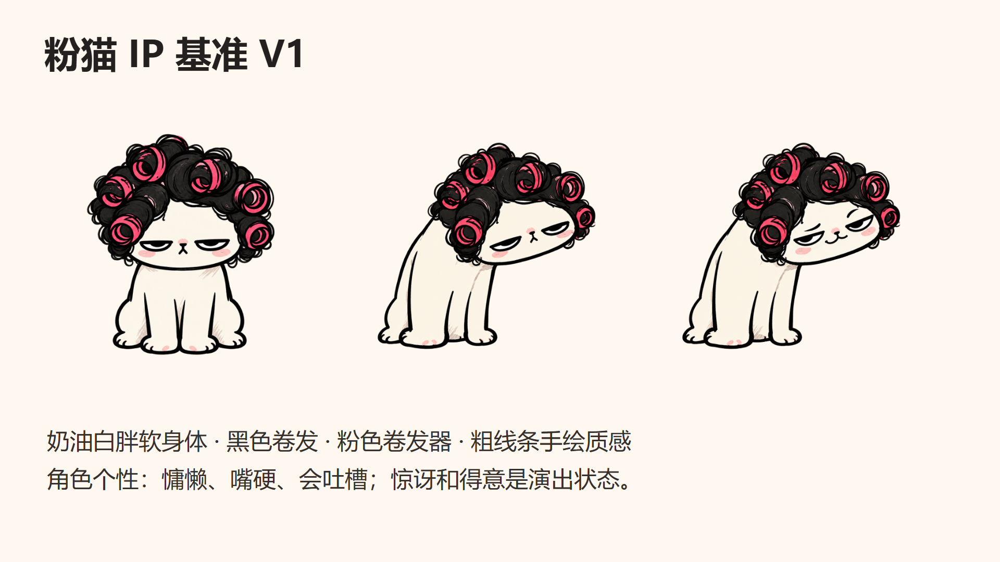

# IP 与风格规范

2026-10-02 · 角色基准不变，用户已确认场景美术 3.0：面向成人女性的日常漫画。

本日补充的动画机制依据 [汗液视频复学与应用](learning-v2/汗液视频复学与应用.md)：主要对象分区画完后继续表演，分镜时按内容选择姿态。这里更新编排与制作要求，已确认的美术基准保持有效。

## 固定这只猫

母版是 `studio/public/ip/cat-sit-neutral.png`，从用户 `IP参考/cat_ip_04.png` 整理为透明素材。固定奶油白胖软身体、黑色卷发、六个粉色卷发器、小鼻口、粗手绘线条和慵懒成年人气质。原始参考完整保留。

- 坐姿 `cat-sit-neutral.png`：跨期身份母版，也是绘出模板的唯一原图。
- 惊讶/得意 `cat-sit-surprised.png`、`cat-sit-proud.png`：用于脸区覆盖，组件内脸外像素仍取母版。
- 正面 `cat-front-neutral.png`、抬爪 `cat-groom.png`：以母版为参考补的关键姿态。新姿态需要检查卷发器数量、体型、线条与透明边缘；不是逐帧连续肢体动画。
- 背身回头 `cat-walk-back.png`：借鉴自有 `IP参考/cat_ip_09.png` 的回头姿态，以母版编辑生成。`WalkingCat.tsx` 在同一 PNG 上连续改变两脚的局部形状并交替抬脚，配合身体摆动、移动与透视缩放，作为扭胯出门模板。步数、时间、路线和终点大小在图层 `walk` 字段中调整；脸部目前沿用该姿态的固定表情。

源 PNG 都是 1254×1254 RGBA。动画阶段使用同一坐标系导出为 1080×1080 RGBA。角色大小和位置由场景图层控制。

## 画面怎样丰富

以 [三张已确认画面](style-v3/画风确认与小样.md) 为当前画风基准。采用近黑的有力度墨线、明确的色面和少量阴影；奶油白、黑色与亮粉保留角色辨识度，灰蓝空间和少量赭黄支撑情境。字幕沿用清晰的深色黑体。

精致感来自明确的构图、尺度与遮挡关系。前景台面、斜线和局部裁切组织画面；中景交代处境，近景让观众读到角色态度。道具沿用猫的粗细不均墨线和简练填色，细节集中在卷发器、表情、手与道具的接触处。背景用瓷砖、镜框等少量真实结构建立空间，不以均匀纸纹或堆装饰代替场景设计。

角色保持半眯眼和克制的反应，用夸张道具、停顿与反差形成成年人的自嘲。标签仅在解释需要时加入，不把温柔纸条、浅粉色卡片、对错符号当作默认画面。生活道具须参与讲述：小样里蓝图占据台面、吊钩带着备用卷发器下降、梳子落到爪边。2.0 的纸面风格与旧样片保留在 [历史修订](style-v2/风格修订.md)，不作为新作品默认画风。

讲述优先增加有意义的信息：可识别线稿/关系 → 分区填色 → 必要细节 → 动作结果/状态反应。线、色、细节可按对象穿插，不强制全场线稿先完成。逐步绘出要用于合适的主要人物、道具和关系，不能仅开头画猫，后续全部展示完成图。约 2—3 秒有信息变化是偏好；允许阅读或笑点停留。同一构图可持续十几秒，不必为了换图拆碎逻辑。

| 关系 | 何时用 | 样片里已实现的例子 |
|---|---|---|
| 直接解释 | 交代处境、关键概念、因果 | 猫绘出后逐步揭示梳妆角 |
| 隐喻 | 把抽象压力或关系变成可见事物 | 脑内施工 → 巨大蓝图与吊车介入梳妆 |
| 反差 | 台词与画面碰撞形成纠偏或笑点 | 收拾一下 → 仿佛要开施工现场 |
| 反应 | 让角色表现理解、犹豫、惊讶或嘴硬 | 半眯眼与小挑眉，给无语反应留停顿 |
| 回扣 | 用前文元素完成结尾 | 收起过大的蓝图，拿起普通小梳子 |

隐喻不能替代重要事实的直接解释。口播要自然能录，必要时让画面承担一部分信息，避免台词逐一朗读全部道具。事实性主题须另查一手来源，参考动画只作为表达机制研究。

## 逐步绘出模板

`studio/src/Cat.tsx` 使用同一母版、真实轮廓路径和 SVG 遮罩，依序显出轮廓/五官、奶油身体、黑卷发、粉卷发器与完整猫。黑发和粉色区域采用局部揭示；并非所有毛发都逐笔重画。

默认绘出 2.4 秒，透明导出总长 3.2 秒；组件 `revealSeconds` 可调。六个绘出阶段沿用同一猫，不独立生成中间图片。这个时长是模板默认值，不是每个镜头的要求。新场景可重新揭示角色；同一场景里优先改变表情、姿态、物件和关系。新姿态的中间阶段从该姿态定稿图派生，身份仍以坐姿母版为准。

`draw` 目前专用于坐姿。正面/抬爪采用状态切换；不把完整新姿态强套进坐姿的遮罩。坐姿和抬爪支持平静、惊讶、得意三个表情。抬爪的 `cat-groom-surprised.png`、`cat-groom-proud.png` 以原姿态和坐姿表情共同作编辑参考，只合成脸部内区，保留姿态原有的发型、下颌和手爪。正面姿态目前使用平静表情。按口播中的态度转折编排 `reactions`，不能只摆姿态而全程保持一张脸。

文字、数字、箭头在后期叠加。道具保持独立图层，长中文不用图像生成，以便校对和修订。1080p 中文口播字幕默认 54px，重点文字常用 64—88px；字幕区留出底部空间。

## 动作从分镜阶段选择

按口播中的实际行为与态度选择趴、坐、举物、拿取、撑地、转身/迈步等姿态；自有参考目录与可用状态见上述复学文档。每个主要动作写清起始、接触/行动、结果和表情转折。多动作是内容需要，不是数量指标；持续同一行为可以保持姿态，但不能让抬爪承担全期所有动词。

坐姿、正面、抬爪与背身步态已可用，其他原始 IP 动作仍需以母版整理后按镜头制作。换身体姿态时检查身份、重心、手爪接触、道具位置和接地影；颜色/脸区切换、整体晃动都不能替代缺失的身体状态。生活空间与留白解释图按内容选用，保留当前成人漫画的笔触、构图与克制幽默。

## 每期最低检查

看真实关键帧与视频：猫是否仍可辨认，爪子与发丝是否被截掉，标签是否遮脸，变化是否推进内容，隐喻是否看得懂；猫、道具、文字的画法是否协调，空间或色块是否帮助看清主次。录音后按句段和关键词重排并听看关键动作；静态截图不证明动态节奏与音画同步。
