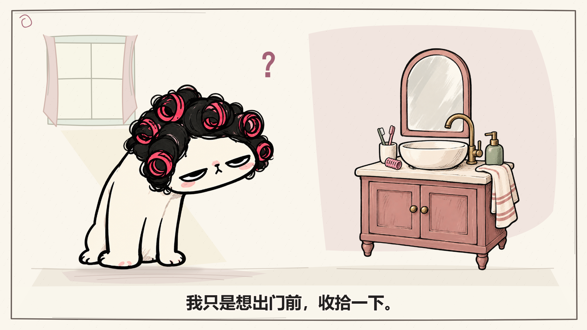
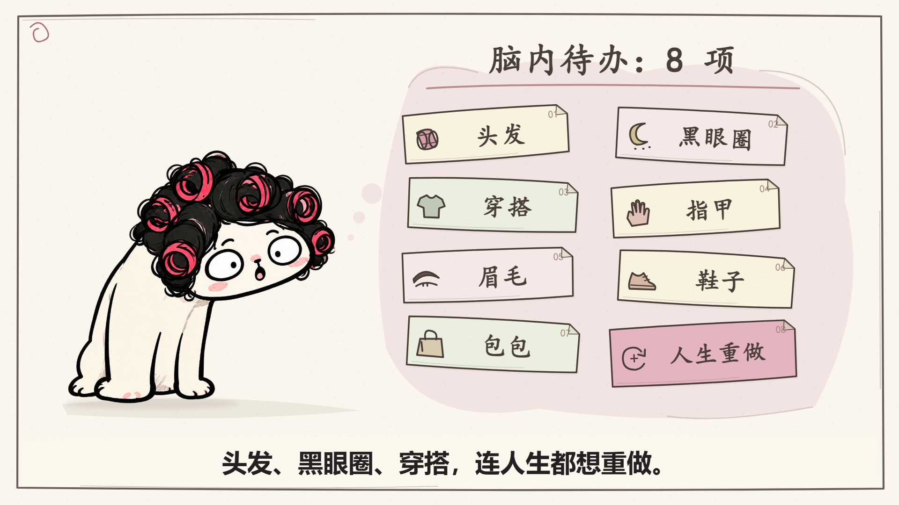

# 场景美术修订 2.0

2026-10-02。保留猫猫形象、开头绘出、32 秒总长、原口播与全部 23 个视觉事件的时间，重做场景美术。仍是一份主表、三个 Skill、当前 Agent 顺序制作。

## 为什么原版显得简陋

本轮重新看了本地 `FALCON_OPEN-01.jpg`、`SLEEP-01.jpg`、`MOSQUITO-01.jpg` 参考联系图。可观察到参考也有大片纯色与留白，但手绘边框、纸面颗粒、填色笔触、物件比例和少量强调色较统一。精致感不能简单归因于背景画得多；这些画面观察也不证明参考作者使用了哪种软件。

原 DEMO 的猫有黑卷发和细密手绘笔触，洗手台却是孤立的几何图标，任务卡像默认界面。问题在画法与主次不协调。

## 本次实际改动

- 梳妆角：重画镜子、陶瓷盆、柜体、龙头、毛巾与洗漱小物。淡窗光、地面与阴影让猫和柜体处于同一空间。
- 脑内待办：改用轻微错位的纸条、手绘小图标和灰粉/浅绿/奶油三种纸色；最后的“人生重做”保留最显眼的粉色。
- 施工反差与出门：重画施工道具和半开门口，延续同一墨线、填色笔触和配色。重点仍是猫的表情与讲述关系。
- 背景：统一轻纸纹、手绘细边框；生活场景有少量空间线索，解释场景保留大片留白。标题使用手写感字形，口播字幕继续采用清晰黑体。

主要新素材保存在 `studio/public/props/style-v2/`。三张栅格图直接采用 imagegen 透明输出，未做后处理裁切；梳子与纸条为独立 SVG。完整提示词、参考文件、原始输出路径见 [生成记录](complete-imagegen-prompts.json)。

## 查看与复现

- [新版 32 秒无声 MP4](../../exports/DEMO/DEMO_无声.mp4)
- [无烧录字幕版](../../exports/DEMO/DEMO_无声_无字幕.mp4)
- [原版保留目录](../../exports/DEMO/history/style-v1/)
- [口播与关键画面](../../episodes/DEMO/review/review.html)
- [本轮验证记录](verification.json)

在项目根目录执行 `./Start-Cat.ps1 -Action preview -Episode DEMO` 预览；修改主表后 `-Action review -Overwrite`，再 `-Action render -Silent -Overwrite`。旧源码未另起项目，美术仍从现有主表引用。

尚未提供正式口播录音，本样片仍使用预计时间与无声导出。

本轮 TypeScript 与主表校验通过。两个新版 MP4 都是 1920×1080、30fps、960 帧、32 秒且无音频流，完整解码通过；独立 SRT 与原版相同。开头 0.5、1.5、2 秒的原生取样帧变化像素均为 0，母版与绘出组件哈希不变。五场景代表状态、背景加入前后和梳子动作状态已实际看图。

带字幕新版在本地播放器实际从 0.28 秒推进到 32 秒结尾，`ended=true`、`readyState=4`、无媒体错误；任务段另从 6 秒开始播放，确认可重新定位。工程中梳妆场景可加载，未出现 Remotion 错误浮层。这些是技术与可播放性检查，审美仍以实际观看为准。
