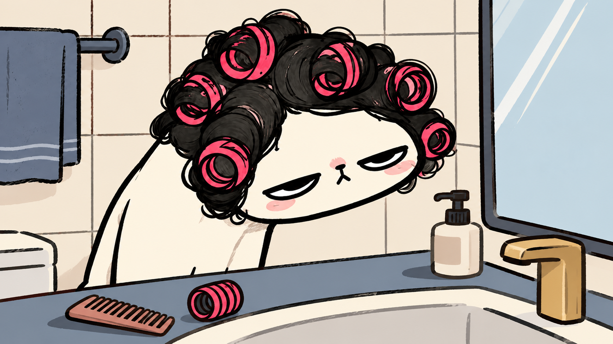
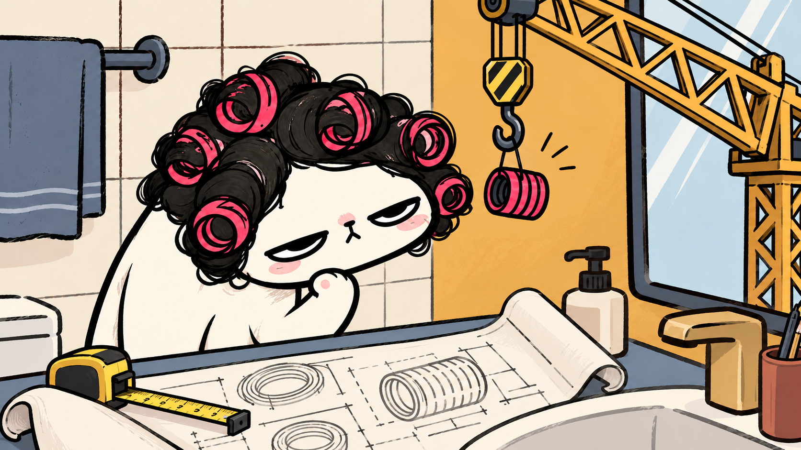
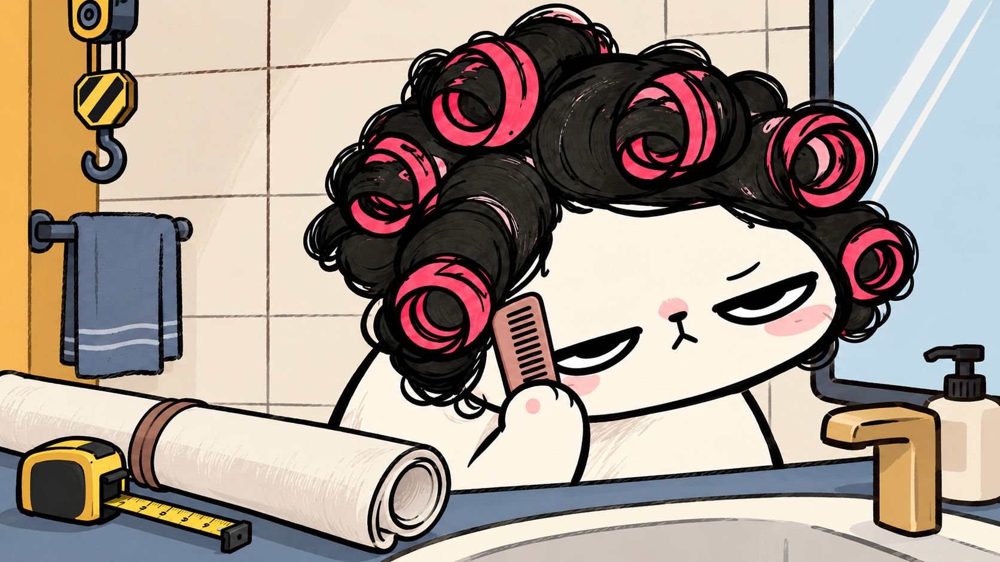

# 画风 3.0 与 12 秒小样

2026-10-02，用户确认以下三张静态范例，并授权按这一画风制作约 12 秒小样。当前定位为面向成人女性的日常漫画：有力度的墨线、有限色面、真实空间关系与克制的自嘲。

| 镜前挑剔 | 脑内施工 | 无语收工 |
|---|---|---|
|  |  |  |

## 已交付的 STYLE12

- [12 秒无声、无烧录字幕 MP4](../../exports/STYLE12/STYLE12_无声_无字幕.mp4)
- [完整口播与分镜主表](../../episodes/STYLE12/episode.json)、[审阅页](../../episodes/STYLE12/review/review.html)
- [独立预计 SRT](../../exports/STYLE12/STYLE12.srt) 与同目录 `episode.snapshot.json`

| 时间 | 画面与动作 | 口播语义参考 |
|---|---|---|
| 0–3.2 秒 | 同一猫母版从轮廓、黑卷发到粉卷发器逐步成形；台面加入梳子和备用卷发器。 | 我只是想收拾一下。 |
| 3.2–8.4 秒 | 抬爪思考，工程蓝图铺开；吊臂介入，备用卷发器下降并停稳；挑眉，蓝图收起，吊钩升回。 | 脑子里却开始施工了。 |
| 8.4–12 秒 | 切情绪近景；卷起的计划保留在前景，普通小梳子来到爪边；挑眉后停顿。 | 算了，先梳头。 |

猫的母版、原绘出遮罩与已有抬爪姿态保持固定。背景由已确认梳妆画面去除猫和活动道具得到；六个道具组使用真实 alpha 图集，通过独立图层、局部裁切、遮挡和关键时刻移动合成。新增素材与完整生成提示词见 [生成记录](generation-record.json) 和 [图集坐标](atlas.json)。

本次包含逐步揭示、道具运动与关键姿态切换，不是连续肢体逐帧动画。未提供声音，未进行录音对齐；所有事件和 SRT 使用预计时间。本次授权仅覆盖画风与 STYLE12 小样，后续主题仍按完整口播和分镜审核。

## 复现与验证

```powershell
./Start-Cat.ps1 -Action check -Episode STYLE12
./Start-Cat.ps1 -Action review -Episode STYLE12
./Start-Cat.ps1 -Action render -Episode STYLE12 -Silent -Clean
# 授权修订后的已有输出，加 -Overwrite 重导。
```

MP4 为 1920×1080、30fps、360 帧、12.000 秒，H.264/yuv420p；仅视频流，无音频流。主表检查和 TypeScript 检查通过；FFmpeg 完整解码无错误。实际导出文件已在浏览器从头播放到 12 秒结束，未报告媒体错误，并检查绘出、吊钩、蓝图与持梳子的关键状态。技术记录见本地 `exports/STYLE12/qa/verification.json`；动态播放与静态检查分别记录，不据此宣称音画同步。

旧 2.0 纸面构图、素材和 32 秒样片保留；新作品默认遵循这套已确认的漫画范例，不需要新增软件、角色代理或另一套生产系统。
